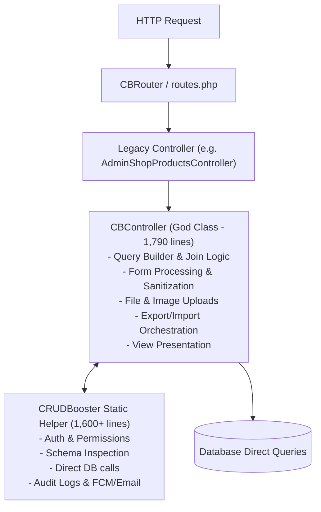
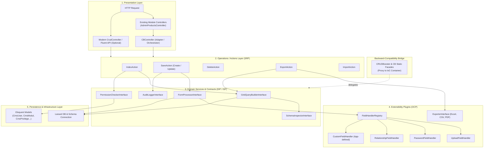
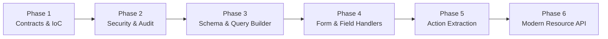

# CRUDBooster SOLID Architecture Redesign Specification

## 1. Executive Summary & Architectural Goals

CRUDBooster is a widely used rapid backend and CRUD generator for Laravel. In version 7.x, the framework has been successfully upgraded to support PHP 8.2–8.5 and Laravel 12/13 while preserving the classic 5.x architecture.

However, the classic codebase suffers from classical architectural debt:
- **God Class Anti-Pattern**: `CBController.php` (1,790 lines) and `CRUDBooster.php` (1,600+ lines) encapsulate dozens of unrelated responsibilities (session auth, RBAC permissions, database schema introspection, query generation, complex multi-table joins, form parsing, file uploads, image transformations, audit logging, export/import handling, and view rendering).
- **Hardcoded Static Coupling**: Methods rely directly on static facades (`DB::`, `Session::`, `Request::`, `CRUDBooster::`), preventing unit testing and dependency injection.
- **Modification over Extension (OCP violation)**: Adding a new field type, export format, or custom validation logic currently requires editing large switch/if-else ladders within `CBController`.

### The Core Objective
Redesign the framework according to **SOLID** principles and modern Laravel design patterns while **preserving 100% backward compatibility** for all existing applications, controllers, and modules.

> [!IMPORTANT]
> **Zero Breaking Changes Guarantee**:
> 1. Existing module controllers extending `CBController` and defining `cbInit()`, `$this->table`, `$this->col`, `$this->form`, and `hook_*()` will continue to work without changing a single line of code.
> 2. Existing static calls to `CRUDBooster::*` and `CB::*` will remain intact, operating as backward-compatible facade proxies to underlying container services.
> 3. Existing blade views, routes, database tables, and configuration files will continue to function unchanged.

---

## 2. Current Architecture vs. New SOLID Architecture

### Current Monolithic Architecture



### Proposed SOLID Layered Architecture



---

## 3. SOLID Principles Application Matrix

| Principle | Classic CRUDBooster Problem | Redesigned SOLID Solution |
| :--- | :--- | :--- |
| **S - Single Responsibility** | `CBController` and `CRUDBooster` do auth, schema, query building, validation, file upload, export, import, logging. | Decompose into focused services: `SchemaInspector`, `GridQueryBuilder`, `FormProcessor`, `PermissionManager`, `AuditLogger`, `Action` classes. |
| **O - Open / Closed** | Adding new field types or export formats requires editing core controller switch/if statements. | Registry & Strategy patterns: `FieldHandlerRegistry` with `FieldHandlerInterface`, `ExporterRegistry` with `ExporterInterface`. New fields can be added from plugins without touching core files. |
| **L - Liskov Substitution** | Concrete static methods and classes cannot be swapped, subclassed, or mocked in tests. | Controllers and services depend on interfaces (`PermissionCheckerInterface`, `AuditLoggerInterface`, etc.). Custom implementations can replace defaults in the container. |
| **I - Interface Segregation** | Large god-interfaces or monolithic classes force callers to know about everything. | Micro-interfaces: `AuditLoggerInterface`, `PermissionCheckerInterface`, `GridQueryBuilderInterface`, `SchemaInspectorInterface`. Consumers depend only on the methods they use. |
| **D - Dependency Inversion** | High-level modules directly depend on low-level global singletons and static helpers (`Session`, `DB`, `Request`). | High-level operations depend on domain interfaces injected through Laravel's service container. Legacy facades act as lightweight adapters. |

---

## 4. Domain Decomposition & Package Structure

The package directory structure in `src/` will be organized into clear domain boundaries:

```text
src/
├── Contracts/                          <-- [ISP / DIP] Clean interface contracts
│   ├── Security/
│   │   ├── AuthenticationServiceInterface.php
│   │   └── PermissionCheckerInterface.php
│   ├── Schema/
│   │   └── SchemaInspectorInterface.php
│   ├── Grid/
│   │   ├── GridQueryBuilderInterface.php
│   │   └── GridFilterParserInterface.php
│   ├── Forms/
│   │   ├── FormProcessorInterface.php
│   │   ├── FormValidatorInterface.php
│   │   └── FieldHandlerInterface.php
│   ├── Actions/
│   │   └── CrudActionInterface.php
│   ├── Export/
│   │   └── ExporterInterface.php
│   └── Audit/
│       └── AuditLoggerInterface.php
│
├── Security/                           <-- Auth & RBAC Domain
│   ├── AdminAuthenticationService.php  (Already started in 7.0!)
│   ├── AdminAuthenticationContext.php
│   ├── PermissionManager.php           (Implements PermissionCheckerInterface)
│   └── PrivilegeService.php
│
├── Schema/                             <-- Database Introspection & Metadata Cache
│   ├── SchemaInspector.php             (Implements SchemaInspectorInterface)
│   └── TableMetadata.php
│
├── Grid/                               <-- Data Table & Index Logic
│   ├── GridQueryBuilder.php            (Handles joins, subqueries, search, sorts)
│   ├── GridFilterParser.php            (Handles CB URL filter format)
│   └── GridResult.php                  (Pagination & collection DTO)
│
├── Forms/                              <-- Input Handling & Form Lifecycle
│   ├── FormProcessor.php               (Orchestrates before-save, save, after-save)
│   ├── FormValidator.php               (Extracts validation rules & runs Validator)
│   ├── FieldHandlerRegistry.php        (OCP: Extensible field processor registry)
│   └── Handlers/                       (Individual field type strategies)
│       ├── TextFieldHandler.php
│       ├── PasswordFieldHandler.php
│       ├── UploadFieldHandler.php
│       ├── CheckboxRelationHandler.php
│       └── Select2RelationHandler.php
│
├── Actions/                            <-- Single Responsibility Action Handlers
│   ├── IndexAction.php                 (Handles getIndex & postDataQuery)
│   ├── DetailAction.php                (Handles getDetail & modal views)
│   ├── SaveAction.php                  (Handles postAddSave & postEditSave)
│   ├── DeleteAction.php                (Handles getDelete & soft/cascade delete)
│   ├── BulkAction.php                  (Handles postActionSelected)
│   ├── ExportAction.php                (Handles getExportData & postExportData)
│   └── ImportAction.php                (Handles chunked data import)
│
├── Export/                             <-- Strategy-based Exporters (OCP)
│   ├── ExporterRegistry.php
│   ├── ExcelExporter.php
│   ├── CsvExporter.php
│   └── PdfExporter.php
│
├── Audit/                              <-- Audit & Logging Domain
│   ├── AuditLogger.php                 (Implements AuditLoggerInterface)
│   └── LogContext.php
│
├── Compatibility/                      <-- Backward Compatibility Bridge
│   ├── CBControllerBridge.php          (Trait or delegator for legacy CBController)
│   └── CrudConfigDTO.php               (Encapsulates $this->table, $this->col, etc.)
│
├── controllers/                        <-- Maintained for 100% BC
│   ├── CBController.php                (Extends Controller; delegates to Actions)
│   ├── AdminController.php
│   └── ...
│
├── helpers/                            <-- Maintained for 100% BC
│   ├── CRUDBooster.php                 (Static facade forwarding to container services)
│   ├── CB.php
│   └── ...
│
└── CRUDBoosterServiceProvider.php      <-- Container bindings & IoC configuration
```

---

## 5. Backward Compatibility Strategy

How do we guarantee that existing modules like `AdminShopProductsController` continue working seamlessly without any edits?

### 1. The Controller Adapter Pattern
In existing code:
```php
class AdminShopProductsController extends CBController
{
    public function cbInit()
    {
        $this->table = 'shop_products';
        $this->primary_key = 'id';
        $this->col = [...];
        $this->form = [...];
    }
}
```

In the redesigned `CBController`:
- All public properties (`$this->table`, `$this->col`, `$this->form`, `$this->button_*`, hooks) remain exactly as they are.
- In `cbLoader()`, `CBController` packages its configuration properties into an immutable `CrudConfigDTO`.
- Action methods (such as `getIndex()`, `postAddSave()`, `getDelete()`) simply resolve their corresponding Action class from the container and execute it, passing `$this` or the config DTO:

```php
// Inside redesigned CBController.php:
public function getIndex()
{
    $this->cbLoader();
    $action = app(IndexAction::class);
    return $action->execute($this);
}

public function postAddSave()
{
    $this->cbLoader();
    $action = app(SaveAction::class);
    return $action->execute($this, mode: 'create');
}
```
Existing hooks (`hook_before_add`, `hook_query_index`, etc.) are invoked by the Action classes via the controller reference, preserving the exact execution lifecycle.

### 2. The Facade Proxy Pattern for `CRUDBooster`
Currently, user code and views call static methods:
`CRUDBooster::myId()`
`CRUDBooster::isCreate()`
`CRUDBooster::insertLog($text)`
`CRUDBooster::getSetting($name)`

In the redesigned `CRUDBooster.php`:
The static methods remain, but their internal implementations become one-line delegations to the container interface:

```php
// Inside helpers/CRUDBooster.php:
public static function myId(): ?int
{
    return app(AuthenticationServiceInterface::class)->currentUserId();
}

public static function isCreate(): bool
{
    return app(PermissionCheckerInterface::class)->canCreate();
}

public static function insertLog(string $description, string $details = ''): void
{
    app(AuditLoggerInterface::class)->log($description, $details);
}

public static function getTableColumns(string $table): array
{
    return app(SchemaInspectorInterface::class)->getColumnNames($table);
}
```

This transforms `CRUDBooster` from a God Helper into a convenient Laravel Facade, while business logic resides in testable, injectable services.

---

## 6. Detailed Design of Key SOLID Components

### A. The Extensible Field Handler System (OCP)
Currently, `CBController::input_assignment()` has a 200-line `switch($ro['type'])` with hardcoded cases for `upload`, `password`, `checkbox`, `select2`, etc.

**New SOLID Design**:
1. `FieldHandlerInterface`:
```php
namespace crocodicstudio\crudbooster\Contracts\Forms;

interface FieldHandlerInterface
{
    public function supports(string $type): bool;
    
    public function beforeSave(
        array $fieldConfig,
        mixed $value,
        array &$savePayload,
        ?int $recordId = null
    ): void;

    public function afterSave(
        array $fieldConfig,
        mixed $value,
        int|string $recordId
    ): void;
}
```

2. Dedicated Handlers (SRP):
- `UploadFieldHandler`: Handles file validation, disk storage, image resizing, and path generation.
- `PasswordFieldHandler`: Handles bcrypt/argon hashing or skipping empty passwords on edit.
- `RelationshipFieldHandler`: Handles many-to-many pivot insertions and child table sync.

3. `FieldHandlerRegistry` (OCP):
Developers or plugins can register custom field types dynamically:
```php
$registry->register('signature', new SignatureFieldHandler());
$registry->register('s3_file', new S3UploadFieldHandler());
```
Core controllers no longer need to be modified when new UI field types are introduced.

### B. Clean Grid Query Builder (SRP & DIP)
Currently, `CBController::getIndex()` contains over 400 lines of raw SQL string concatenation, alias generation, and nested join logic.

**New SOLID Design**:
- `GridQueryBuilder` is responsible purely for taking the table, column specifications, filters, and soft delete settings and returning a prepared Eloquent/Database query builder.
- Can be tested in isolation with SQLite in-memory without invoking any HTTP controllers.

```php
namespace crocodicstudio\crudbooster\Contracts\Grid;

interface GridQueryBuilderInterface
{
    public function buildQuery(
        string $tableName,
        array $columns,
        array $options = []
    ): \Illuminate\Database\Query\Builder;

    public function applyFilters(
        \Illuminate\Database\Query\Builder $query,
        array $filterParams
    ): \Illuminate\Database\Query\Builder;
}
```

### C. Permissions & Security (ISP)
Split the auth and permission duties:
- `AuthenticationServiceInterface`: Who is the user? (login, logout, lockscreen, user context).
- `PermissionCheckerInterface`: What can the user do in the current module? (`canRead()`, `canCreate()`, `canUpdate()`, `canDelete()`, `canView()`).

Controllers and blade directives only ask `PermissionCheckerInterface`, making it simple to plug in Laravel's native Gates/Policies or Spatie Permission in the future if desired.

---

## 7. Migration & Implementation Roadmap

To maintain total stability and avoid regressions across the existing 94 tests, the redesign will follow a phased, incremental approach:



### Phase 1: Contracts & Service Container Setup
- Define the interfaces in `src/contracts/`.
- Bind interfaces to default implementations in `CRUDBoosterServiceProvider`.
- Keep the legacy static helper and controller APIs unchanged.
- Run tests (`phpunit`) to verify zero disruption. **Implemented.**

### Phase 2: Security, Permissions & Audit Logging
- Extract `PermissionManager` (implementing `PermissionCheckerInterface`) using existing `CmsPrivilege` / `CmsPrivilegeRole` models.
- Extract `AuditLogger` (implementing `AuditLoggerInterface`) using `CmsLog` model.
- Delegate `CRUDBooster::myId()`, `CRUDBooster::isView()`, `CRUDBooster::isCreate()`, `CRUDBooster::isRead()`, `CRUDBooster::isUpdate()`, `CRUDBooster::isDelete()`, and `CRUDBooster::insertLog()` to these services.
- Verify tests pass. **Implemented.**

### Phase 3: Schema Inspector & Grid Query Builder
- Extract database column reflection and primary key caching into `SchemaInspector`.
- Extract index query construction, joins, and filter parsing into `GridQueryBuilder`.
- Delegate `CBController::getIndex()` query creation to `GridQueryBuilder`.
- Schema metadata and filter parsing are now behind `SchemaInspectorInterface` and `GridFilterParserInterface`; the full query builder extraction remains the next step.
- Verify grid rendering, pagination, and sorting tests pass.

### Phase 4: Form Processor & Field Handler Registry
- Build `FieldHandlerRegistry` with standard handlers (`UploadFieldHandler`, `PasswordFieldHandler`, `RelationshipFieldHandler`).
- Extract `validation()` and `input_assignment()` into `FormProcessor`.
- Verify form submissions, validations, and uploads in playground and test suite.

### Phase 5: Action Orchestrator Refactoring
- Decompose `CBController`'s monolithic methods into discrete actions:
  - `IndexAction`, `SaveAction`, `DeleteAction`, `DetailAction`, `ExportAction`, `ImportAction`.
- `CBController` methods become clean, thin delegates to these Actions.
- Ensure all 94 PHPUnit tests and playground workflows continue to pass with 100% green status.

### Phase 6 (Bonus): Optional Modern CrudController API
- Add a modern, fluent module definition syntax for developers creating brand-new modules in Laravel 12/13, while preserving classic `CBController` for legacy modules.

---

## 8. Summary of Benefits

1. **Maintainability**: `CBController.php` shrinks from 1,790 lines to ~200 lines of clear delegation.
2. **Testability**: Every component (Query Builder, Form Processor, Field Handlers, Permissions) can be unit-tested independently with mocks.
3. **Extensibility**: Adding custom fields or export drivers requires writing a single class and registering it, without modifying vendor code.
4. **Reliability**: Legacy projects upgrade with zero breaking changes; classic controllers and static helper methods continue to behave identically.
