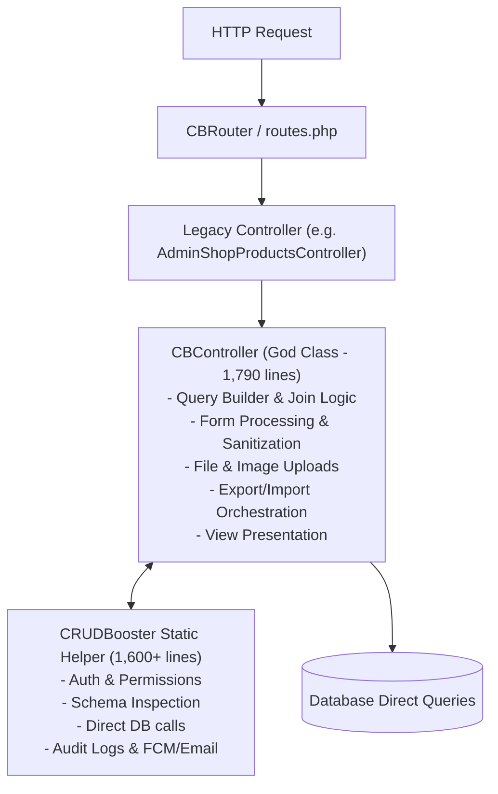
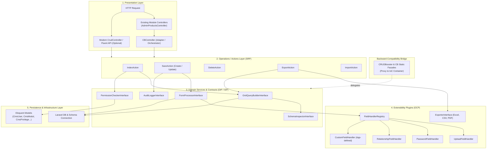
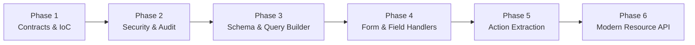
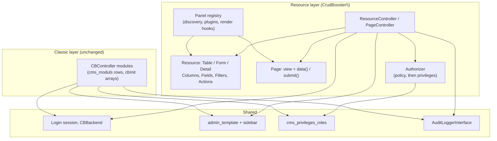

# CRUDBooster SOLID Architecture Redesign Specification

## 1. Executive Summary & Architectural Goals

CRUDBooster is a widely used rapid backend and CRUD generator for Laravel. In version 7.x, the framework has been successfully upgraded to support PHP 8.2–8.5 and Laravel 12/13 while preserving the classic 5.x architecture.

However, the classic codebase suffers from classical architectural debt:
- **God Class Anti-Pattern**: `CBController.php` (1,790 lines) and `CRUDBooster.php` (1,600+ lines) encapsulate dozens of unrelated responsibilities (session auth, RBAC permissions, database schema introspection, query generation, complex multi-table joins, form parsing, file uploads, image transformations, audit logging, export/import handling, and view rendering).
- **Hardcoded Static Coupling**: Methods rely directly on static facades (`DB::`, `Session::`, `Request::`, `CRUDBooster::`), preventing unit testing and dependency injection.
- **Modification over Extension (OCP violation)**: Adding a new field type, export format, or custom validation logic currently requires editing large switch/if-else ladders within `CBController`.

### The Core Objective
Redesign the framework according to **SOLID** principles and modern Laravel design patterns while **preserving 100% backward compatibility** for all existing applications, controllers, and modules.

> [!IMPORTANT]
> **Zero Breaking Changes Guarantee**:
> 1. Existing module controllers extending `CBController` and defining `cbInit()`, `$this->table`, `$this->col`, `$this->form`, and `hook_*()` will continue to work without changing a single line of code.
> 2. Existing static calls to `CRUDBooster::*` and `CB::*` will remain intact, operating as backward-compatible facade proxies to underlying container services.
> 3. Existing blade views, routes, database tables, and configuration files will continue to function unchanged.

---

## 2. Current Architecture vs. New SOLID Architecture

### Current Monolithic Architecture



### Proposed SOLID Layered Architecture



---

## 3. SOLID Principles Application Matrix

| Principle | Classic CRUDBooster Problem | Redesigned SOLID Solution |
| :--- | :--- | :--- |
| **S - Single Responsibility** | `CBController` and `CRUDBooster` do auth, schema, query building, validation, file upload, export, import, logging. | Decompose into focused services: `SchemaInspector`, `GridQueryBuilder`, `FormProcessor`, `PermissionManager`, `AuditLogger`, `Action` classes. |
| **O - Open / Closed** | Adding new field types or export formats requires editing core controller switch/if statements. | Registry & Strategy patterns: `FieldHandlerRegistry` with `FieldHandlerInterface`, `ExporterRegistry` with `ExporterInterface`. New fields can be added from plugins without touching core files. |
| **L - Liskov Substitution** | Concrete static methods and classes cannot be swapped, subclassed, or mocked in tests. | Controllers and services depend on interfaces (`PermissionCheckerInterface`, `AuditLoggerInterface`, etc.). Custom implementations can replace defaults in the container. |
| **I - Interface Segregation** | Large god-interfaces or monolithic classes force callers to know about everything. | Micro-interfaces: `AuditLoggerInterface`, `PermissionCheckerInterface`, `GridQueryBuilderInterface`, `SchemaInspectorInterface`. Consumers depend only on the methods they use. |
| **D - Dependency Inversion** | High-level modules directly depend on low-level global singletons and static helpers (`Session`, `DB`, `Request`). | High-level operations depend on domain interfaces injected through Laravel's service container. Legacy facades act as lightweight adapters. |

---

## 4. Domain Decomposition & Package Structure

The package keeps its lowercase top-level directories (`controllers/`, `helpers/`, `export/`, ...), so the new
domains follow the same convention. A capitalized `Export/` next to the existing `export/` would collide on
case-insensitive file systems such as the macOS default.

```text
src/
├── contracts/                          <-- [ISP / DIP] Interfaces
│   ├── Actions/CrudActionInterface.php
│   ├── Audit/AuditLoggerInterface.php
│   ├── Export/ExporterInterface.php
│   ├── Files/FileUploaderInterface.php
│   ├── Forms/FieldHandlerInterface.php, FormProcessorInterface.php, FormValidatorInterface.php
│   ├── Generator/ModuleGeneratorInterface.php, ApiGeneratorInterface.php
│   ├── Grid/GridQueryBuilderInterface.php, GridFilterParserInterface.php
│   ├── Mail/TemplateMailerInterface.php
│   ├── Modules/ModuleRegistrarInterface.php
│   ├── Navigation/MenuRepositoryInterface.php
│   ├── Notifications/NotificationSenderInterface.php
│   ├── Schema/SchemaInspectorInterface.php
│   ├── Security/AuthenticationServiceInterface.php, PermissionCheckerInterface.php, PrivilegeRolesInterface.php
│   └── Settings/SettingsRepositoryInterface.php
│
├── models/                             <-- Eloquent models for CRUDBooster's own cms_* tables
│   └── CmsMenu.php, CmsModul.php, ...  (relations and named query scopes; see Phase 8)
│
├── security/                           <-- Auth & RBAC
│   ├── AdminAuthenticationService.php  (login, logout, lock screen, password reset)
│   ├── AdminAuthenticationContext.php
│   ├── SessionAuthenticationService.php (implements AuthenticationServiceInterface)
│   ├── PermissionManager.php           (implements PermissionCheckerInterface)
│   └── PrivilegeRoles.php              (role matrix, session roles; implements PrivilegeRolesInterface)
├── audit/AuditLogger.php               (implements AuditLoggerInterface)
├── schema/SchemaInspector.php          (columns, primary keys, types, nullability, cached)
│
├── grid/                               <-- Index page
│   ├── GridQueryBuilder.php            (joins, subqueries, search, where, filters, ordering)
│   ├── GridFilterParser.php            (the filter_column URL format)
│   ├── GridQuery.php                   (query + resolved columns DTO)
│   └── GridRowRenderer.php             (cell HTML, row buttons, hook_row_index)
│
├── forms/                              <-- Input handling
│   ├── FormContext.php                 (table, primary key, create/edit, record id)
│   ├── FormProcessor.php               (input_assignment and the after-save step)
│   ├── FormValidator.php               (validation)
│   ├── FieldHandlerRegistry.php        (OCP: type => handler)
│   └── handlers/                       BaseFieldHandler, Text, Money, Select, Select2, Checkbox,
│                                       Multitext, GoogleMaps, Upload, FileManager, Child (+ SyncsPivotTable)
├── files/FileUploader.php              (uploads, image resizing, thumbnails)
│
├── actions/                            <-- One class per endpoint
│   ├── CrudAction.php                  (shared permission check / logging)
│   ├── IndexAction.php, FormAction.php (add/edit forms), DetailAction.php, SaveAction.php,
│   ├── DeleteAction.php (+ delete image), BulkAction.php, ExportAction.php, ImportAction.php
│   └── LookupAction.php                (find-data, data-table, modal-data)
│
├── export/                             <-- Strategy-based exporters (OCP)
│   ├── ExporterRegistry.php, PdfExporter.php, ExcelExporter.php, CsvExporter.php
│   └── DefaultExportXls.php, DefaultImportRows.php (unchanged)
│
├── settings/SettingsRepository.php     (cms_settings, cached under the 5.x "setting_{name}" keys)
├── navigation/MenuRepository.php       (sidebar and dashboard menus for the current privilege)
├── mail/TemplateMailer.php             (email templates, the queue, the SMTP mailer)
├── notifications/NotificationSender.php (cms_notifications)
├── modules/ModuleRegistrar.php         (the sidebar menus that come with a module)
├── generator/                          <-- Module and API code generators
│   ├── ModuleGenerator.php, ApiGenerator.php
│   └── stubs/module_controller.stub, api_controller.stub
│
├── compatibility/CrudConfig.php        <-- Immutable module configuration (props <-> fluent API)
├── modern/                             <-- Phase 6 fluent API
│   ├── CrudController.php, CrudDefinition.php, Column.php, Field.php
│
├── controllers/CBController.php        <-- Same public API, delegates to actions/
├── helpers/CRUDBooster.php, CB.php     <-- Same static API, delegates to contracts
└── CRUDBoosterServiceProvider.php      <-- Container bindings
```

---

## 5. Backward Compatibility Strategy

How do we guarantee that existing modules like `AdminShopProductsController` continue working seamlessly without any edits?

### 1. The Controller Adapter Pattern
In existing code:
```php
class AdminShopProductsController extends CBController
{
    public function cbInit()
    {
        $this->table = 'shop_products';
        $this->primary_key = 'id';
        $this->col = [...];
        $this->form = [...];
    }
}
```

In the redesigned `CBController`:
- All public properties (`$this->table`, `$this->col`, `$this->form`, `$this->button_*`, hooks) remain exactly as they are.
- In `cbLoader()`, `CBController` packages its configuration properties into an immutable `CrudConfigDTO`.
- Action methods (such as `getIndex()`, `postAddSave()`, `getDelete()`) simply resolve their corresponding Action class from the container and execute it, passing `$this` or the config DTO:

```php
// Inside redesigned CBController.php:
public function getIndex()
{
    $this->cbLoader();
    $action = app(IndexAction::class);
    return $action->execute($this);
}

public function postAddSave()
{
    $this->cbLoader();
    $action = app(SaveAction::class);
    return $action->execute($this, mode: 'create');
}
```
Existing hooks (`hook_before_add`, `hook_query_index`, etc.) are invoked by the Action classes via the controller reference, preserving the exact execution lifecycle.

### 2. The Facade Proxy Pattern for `CRUDBooster`
Currently, user code and views call static methods:
`CRUDBooster::myId()`
`CRUDBooster::isCreate()`
`CRUDBooster::insertLog($text)`
`CRUDBooster::getSetting($name)`

In the redesigned `CRUDBooster.php`:
The static methods remain, but their internal implementations become one-line delegations to the container interface:

```php
// Inside helpers/CRUDBooster.php:
public static function myId(): ?int
{
    return app(AuthenticationServiceInterface::class)->currentUserId();
}

public static function isCreate(): bool
{
    return app(PermissionCheckerInterface::class)->canCreate();
}

public static function insertLog(string $description, string $details = ''): void
{
    app(AuditLoggerInterface::class)->log($description, $details);
}

public static function getTableColumns(string $table): array
{
    return app(SchemaInspectorInterface::class)->getColumnNames($table);
}
```

This transforms `CRUDBooster` from a God Helper into a convenient Laravel Facade, while business logic resides in testable, injectable services.

---

## 6. Detailed Design of Key SOLID Components

### A. The Extensible Field Handler System (OCP)
Currently, `CBController::input_assignment()` has a 200-line `switch($ro['type'])` with hardcoded cases for `upload`, `password`, `checkbox`, `select2`, etc.

**New SOLID Design**:
1. `FieldHandlerInterface`:
```php
namespace crocodicstudio\crudbooster\contracts\Forms;

interface FieldHandlerInterface
{
    public function supports(string $type): bool;

    public function beforeSave(array $field, mixed $value, array &$payload, FormContext $context): void;

    public function afterSave(array $field, mixed $value, FormContext $context): void;
}
```
`FormContext` carries the module's table, primary key, the mode (create/edit) and the record id. The record id
alone is not enough, because pivot handlers also need the owning table to find their foreign keys.

2. Dedicated Handlers (SRP):
- `UploadFieldHandler`: Handles file validation, disk storage, image resizing, and path generation.
- `PasswordFieldHandler`: Handles bcrypt/argon hashing or skipping empty passwords on edit.
- `RelationshipFieldHandler`: Handles many-to-many pivot insertions and child table sync.

3. `FieldHandlerRegistry` (OCP):
Developers or plugins can register custom field types dynamically:
```php
$registry->register('signature', new SignatureFieldHandler());
$registry->register('upload', S3UploadFieldHandler::class); // replace a built-in type
```
Core controllers no longer need to be modified when new UI field types are introduced.

### B. Clean Grid Query Builder (SRP & DIP)
Currently, `CBController::getIndex()` contains over 400 lines of raw SQL string concatenation, alias generation, and nested join logic.

**New SOLID Design**:
- `GridQueryBuilder` is responsible purely for taking the table, column specifications, filters, and soft delete settings and returning a prepared Eloquent/Database query builder.
- Can be tested in isolation with SQLite in-memory without invoking any HTTP controllers.

```php
namespace crocodicstudio\crudbooster\Contracts\Grid;

interface GridQueryBuilderInterface
{
    // Returns the prepared query plus the columns resolved for the views (field, field_with, type_data...).
    public function buildQuery(string $table, string $primaryKey, array $columns, array $options = []): GridQuery;

    public function applyFilters(Builder $query, array $filterParams): bool;
}
```

### C. Permissions & Security (ISP)
Split the auth and permission duties:
- `AuthenticationServiceInterface`: Who is the user? (login, logout, lockscreen, user context).
- `PermissionCheckerInterface`: What can the user do in the current module? (`canRead()`, `canCreate()`, `canUpdate()`, `canDelete()`, `canView()`).

Controllers and blade directives only ask `PermissionCheckerInterface`, making it simple to plug in Laravel's native Gates/Policies or Spatie Permission in the future if desired.

---

## 7. Migration & Implementation Roadmap



Before Phase 3, `tests/Feature/CrudBehaviourTest.php` pinned down what a classic module does today. It covers
every field type, joins, subquery columns, search, filters, soft deletes, hooks and their order, bulk actions,
export and lookups. Those tests passed against the pre-refactor code, except where a bug was fixed on purpose
(see section 9), and they pass unchanged after it.

### Phase 1: Contracts & Service Container Setup — **Implemented.**
### Phase 2: Security, Permissions & Audit Logging — **Implemented.**
`CRUDBooster::myId()`, `isSuperadmin()`, `isView/Create/Read/Update/Delete()` and `insertLog()` delegate to
the security and audit contracts.

### Phase 3: Schema Inspector & Grid Query Builder — **Implemented.**
- `SchemaInspector` also owns column types and nullability (same cache keys as 5.x).
- `GridQueryBuilder` builds the whole index query and `GridRowRenderer` the cell HTML.

### Phase 4: Form Processor & Field Handler Registry — **Implemented.**
- `validation()` and `input_assignment()` stay public on `CBController`, because modules override and call them.
  They delegate to `FormValidator` and `FormProcessor`.
- The after-save loop (pivot tables, child rows) became each handler's `afterSave()`.
- Uploads moved to `FileUploader`. `CRUDBooster::uploadFile()` and `uploadBase64()` delegate to it.
- Password hashing depends on the field name (`PASSWORD_FIELDS_CANDIDATE`), not on the `password` type, so it
  lives in `BaseFieldHandler` for every type instead of in a separate `PasswordFieldHandler`.

### Phase 5: Action Orchestrator Refactoring — **Implemented.**
- `CBController` shrank from 1,790 to about 440 lines, and most of the rest are its public properties and
  hook stubs. Each endpoint calls `cbLoader()` and then `app(SomeAction::class)->execute($this, ...)`.
- Actions read the controller's live properties and call its hooks and overridable methods (`getIndex()`,
  `validation()`, `input_assignment()`, `actionButtonSelected()`). This keeps the 5.x behaviour of hooks that
  change `$this->arr` or `$this->return_url`, and of modules that override one step.

### Phase 6 (Bonus): Optional Modern CrudController API — **Implemented.**
`modern\CrudController` + `CrudDefinition`, `Column` and `Field` builders. The definition becomes a
`compatibility\CrudConfig`, which is applied to the classic properties, so everything downstream is shared.
See [docs/en/how-to-extend.md](en/how-to-extend.md).

### Phase 7: Remaining helper domains — **Implemented.**
The helper still held whole domains after Phase 5. Each now has a contract, and the static method delegates to it:

| Static helper | Contract | Implementation |
| :--- | :--- | :--- |
| `getSetting()` | `SettingsRepositoryInterface` | `settings\SettingsRepository` |
| `sidebarMenu()`, `sidebarDashboard()` | `MenuRepositoryInterface` | `navigation\MenuRepository` |
| `sendEmail()`, `sendEmailQueue()`, `mailer()` | `TemplateMailerInterface` | `mail\TemplateMailer` |
| `sendNotification()` | `NotificationSenderInterface` | `notifications\NotificationSender` |
| `generateController()`, `getNameTable()` | `ModuleGeneratorInterface` | `generator\ModuleGenerator` |
| `generateAPI()` | `ApiGeneratorInterface` | `generator\ApiGenerator` |

- `tests/Feature/CodeGeneratorTest.php` pins the exact generated source against `tests/fixtures/generated/`,
  because users keep and edit those files. The fixtures were recorded from the pre-refactor generator, and the
  stubs reproduce them byte for byte. Set `CB_UPDATE_GOLDEN=1` to re-record them after an intended change.
- `AuditLogger`, `AdminAuthenticationService` and the `mailqueues` command take these contracts by injection
  instead of calling the static helper.
- `CRUDBooster.php` went from 1,735 to about 900 lines. What is left is mostly request context (`mainpath()`,
  `getCurrentModule()`, `redirect()`), the small query shortcuts (`first()`, `get()`, `insert()`) and
  `routeController()`.

### Phase 8: Laravel models for CRUDBooster's tables — **Implemented.**
About 100 raw `DB::table('cms_…')` calls in the built-in controllers, views, router, middleware and helper now go
through the models in `src/models`. The conventions:

1. **CRUDBooster's own tables (`cms_*`) are read and written only through their models.** A query that is used
   in more than one place, or that encodes a rule, is a named scope on the model: `CmsMenu::visibleTo()`,
   `CmsModul::routable()`, `CmsNotification::visibleTo()->unread()`, `CmsEmailQueue::due()`. Callers never
   repeat the SQL.
2. **Steps that span several tables are services behind contracts.** `PrivilegeRolesInterface` owns the role
   matrix and the session copy of it (five copies of the same query became one). `ModuleRegistrarInterface`
   owns the menus created with a module (two copies). Services take models by constructor injection; controllers,
   views and helpers use `Model::query()` or resolve the contract.
3. **Module data stays on the query builder.** A module's own table is passed to hooks, `callback_php` and views
   that iterate rows, and iterating an Eloquent model yields its properties, not its columns. `CBController`,
   the actions and the form components therefore keep `DB::table($this->table)`.
4. **Legacy shapes are kept where user code can see them.** `CRUDBooster::me()`, `getCurrentModule()`,
   `myPrivilege()` and the `admin_privileges_roles` session key return plain rows through `->toBase()`, as in
   5.x. Login used to store role models there and the refresh plain rows; both now store plain rows.
5. **No `SoftDeletes` on `cms_moduls`.** CBController's delete action writes `deleted_at` itself and some reads
   include deleted modules, so `notDeleted()` is applied explicitly.
6. **Timestamps stay manual.** The models keep `$timestamps = false`, and code sets `created_at` where 5.x did,
   so `updated_at` columns are not suddenly written.
7. **Views do not query.** The privilege, menu and settings pages get their data from the controller (the menu
   page eager-loads children and privileges instead of one query per menu). The settings page no longer writes
   default labels during a GET; `CmsSetting::displayLabel()` derives them.

Tests are split into two PHPUnit suites (`composer test:unit`, `composer test`):
- `tests/Unit`: one model or service at a time, against the test database: every scope and relation, the
  `PrivilegeRoles` and `ModuleRegistrar` services and `SettingsRepository`.
- `tests/Feature`: whole requests. New tests log in as a non-superadmin (`loginAsStandardAdmin()`) to cover
  access control, and cover each bug below. They were checked against the previous code: 8 of the 10 new
  feature tests fail there, one per bug; the other 2 pin down behaviour that must not change.
- The `Coverage` CI job runs the suite with PCOV, prints the summary and uploads a Clover report.
  `composer test:coverage` does the same locally when PCOV or Xdebug is installed.

The seeder keeps its plain inserts: it runs during installation and upgrades, where model behaviour such as
casts adds nothing.

### Phase 9: A code-first resource layer — **Implemented.**
Phases 1–8 cleaned up the internals but kept the developer workflow: generate a module from a table, then edit
arrays in `cbInit()`. Phase 9 adds a second front end on the same services, built for developers instead of
generation. It lives in its own namespace, `CrudBooster\` (`core/`), so it is free of the 5.x API's constraints
while the classic layer stays untouched.



Design rules:
1. **Eloquent first.** A resource names a model; relationships, casts, scopes, events and policies work as
   in any Laravel code. Classic modules keep `DB::table()` (Phase 8, rule 3).
2. **Components are classes, not array keys.** A column, field, filter or action is an object with
   autocompleted options and its own Blade view. A new type is a subclass, so no registry has to be
   edited (the classic layer's `FieldHandlerRegistry` stays for `cbInit()` types).
3. **Closures go through the container.** Every option that takes a closure can ask for `$record`,
   `$state`, `$operation` or any service by name.
4. **The form is the whitelist.** Only declared, visible, enabled fields are read from the request. Rules
   come from the fields, choices are validated against their options or the related table, and records
   are saved with `forceFill()->save()` in a transaction.
5. **Routes come from classes, not the database.** Resources and pages are discovered or registered at
   boot. Their routes are named and support `route:cache`. A slug shared by two classes fails at boot.
6. **Same session, layout and privileges.** Resource routes run behind `CBBackend`. The admin layout gained
   an opt-in `page_header` section and two render hooks; the sidebar appends panel links. Without a policy,
   abilities map onto the classic privilege matrix through the module path (the slug).
   `crudbooster:sync-panel` creates those modules with no controller, so `CBRouter` never routes them.

| Concern | Classic | Resource layer |
| :--- | :--- | :--- |
| Entry point | `CBController` + `cbInit()` | `Resource` / `Page` subclasses |
| Registration | `cms_moduls` row | `app/Admin/*` discovery, `Panel::resources()`, plugins |
| Customisation | `hook_*()`, `$this->col` / `$this->form` arrays | Lifecycle methods, component subclasses, render hooks |
| Authorization | `PermissionCheckerInterface` (privileges) | `Authorizer` (policy, then privileges) |
| Scaffolding | Module Generator (UI) | `crudbooster:make-resource --generate`, `crudbooster:make-page` |

Covered by `tests/Feature/PanelTest.php` (requests through a resource, a read-only resource, a page and a
plugin, as superadmin and as a standard admin), `PanelCommandsTest.php` and `tests/Unit/Panel`.

### Phase 10: Themes for the resource layer — **Implemented.**
The resource layer's screens are now themed, so they can move off Bootstrap without touching resources
or classic modules.

1. **A theme is view paths plus head HTML** (`CrudBooster\Themes\Theme`). `Panel::applyTheme()` points the
   `cb::` view namespace at the theme's directory first, then the default views, so a theme overrides only
   the views it has. Published overrides in `resources/views/vendor/cb` still win. The view finder's cache
   is flushed on a switch.
2. **Shared view names stay theme-neutral.** The AdminLTE sidebar includes `cb::navigation` on classic pages,
   so the Tailwind theme renders its own sidebar partials instead of overriding that view.
3. **React islands, not a single-page app.** Pages stay server-rendered Blade. A field describes itself as
   props (`getComponent()`, `getComponentProps()`), and the theme renders
   `<div data-cb-component data-cb-props>` around a plain HTML fallback that submits the same names.
   Validation, old input, authorization and saving stay on the server, unchanged.
4. **No build step for users.** Vite builds `core/resources/{js,css}` into `src/assets/panel`, committed and
   published with `cb_asset`. Tailwind scans the theme's views and `TailwindTheme`, where the colour and span
   class lists are written out in full. CI rebuilds and fails on a difference.
5. **One React per page.** `window.CrudBooster` exposes `React`, `register()`, `registerMount()`, `mount()`
   and `confirm()` for app scripts, and fires `crudbooster:ready`.
6. **shadcn/ui, owned in the repository.** The islands are TypeScript on shadcn's `base-nova` components (Base
   UI primitives) in `core/resources/js/components/ui`, generated with the shadcn CLI's own transforms and
   configured by `components.json`. The Blade views and the plain-HTML fallbacks use the same Nova classes
   and design tokens, so server-rendered and React parts match.

---

## 8. Summary of Benefits

1. **Maintainability**: `CBController.php` shrinks from 1,790 lines to ~440, most of it the documented public properties and hook stubs.
2. **Testability**: Every component (Query Builder, Form Processor, Field Handlers, Permissions) can be unit-tested independently with mocks.
3. **Extensibility**: Adding custom fields or export drivers requires writing a single class and registering it, without modifying vendor code.
4. **Reliability**: Legacy projects upgrade with zero breaking changes; classic controllers and static helper methods continue to behave identically.

---

## 9. Implementation Notes

### Deviations from the original plan
- **Directory case**: lowercase domain directories (see section 4).
- **No `CBControllerBridge`**: each endpoint delegates in one line, so a trait or delegator would only add
  indirection.
- **`CrudConfig` is a snapshot, not the actions' input**: hooks may change controller properties mid-request,
  so actions read the controller. `CrudConfig` links the classic properties and the fluent API, and
  `CBController::crudConfig()` exposes it read-only.
- **`ImportAction` and `LookupAction`** expose one method per step or endpoint instead of `execute()`, because
  each covers several routes.
- **`ExporterInterface::label()`**: the export dialog lists the registered formats, so custom exporters show up
  in the UI.
- **`AuditLogger` applies the `api_debug_mode` check** that `CRUDBooster::insertLog()` used to do, so every
  caller follows the same policy.

### Bugs fixed along the way
Found by the characterization tests or while moving code:
- A `child` field submitted without rows inserted an empty child row, which failed on NOT NULL columns.
- The `googlemaps` form component crashed with "Array to string conversion" (`$row->$form['latitude']` parses
  differently since PHP 7).
- The `str_limit` column option called `str_limit()`, which Laravel 6 removed.
- Audit log entries lost `created_at` in the Phase 2 extraction.
- `hide_form` was passed to `unserialize()` with objects allowed (PHP object injection). It now allows plain
  values only.
- The select2 `find-data` lookup interpolated the search term into SQL when a `format` was set. It is now a
  bound parameter.
- A bare `unique` rule used a table literally named "unique". It now means the module's table.
- A string `$orderby` with a qualified column (`"table.column,desc"`) produced `table.table.column`.
- `getIndex()` no longer turns a string `$orderby` into an array, which broke a second call on the same instance.
- The `where[column]=value` index parameter used the table of the last listed column instead of the
  module's table.
- XLS/CSV export failed on any cell containing `&` or `<` (found in the playground: the empty-image placeholder
  URL has a bare `&`). The export view escapes cell values for these formats.
- Import no longer calls `exit()` when creating a related row fails; the error surfaces as an exception.
- The forgot-password email showed a literal `[password]`. The user model was passed as template data, and
  iterating a model yields its public properties, not its attributes. Models now contribute their attributes.
- Generating a module for a table with an `is_*` column crashed with "Array to string conversion" (before PHP 8
  it wrote `"dataenum"=>"Array"`). The options are now written as `"1|Paid;0|Un-Paid"`.
- A third module on the same table overwrote `Admin{Name}1Controller`, and a module generated without a name
  became `Admin1Controller`. The generator now picks the first free number after the table or module name.
- Queued email attachments were passed to `unserialize()` with objects allowed. Only plain values are revived now.
- Sending an email with a template slug that does not exist failed with "Attempt to assign property on null". It
  now throws an `InvalidArgumentException` that names the slug.
- The sidebar menu queries interpolated the session's privilege id into SQL. It is now a bound parameter.
- On MySQL, `SchemaInspector::columns()` read `information_schema` without `ORDER BY`, so the Module Generator
  could shuffle columns and form fields.

Found while moving the built-in controllers onto models (Phase 8):
- Security: a standard (non-superadmin) admin could list API secret keys, create, disable or delete API keys,
  generate API controllers (which writes PHP files into `app/Http/Controllers`), delete them, read any table's
  columns through the API generator, change statistic dashboards and delete setting files. Those endpoints now
  require a superadmin, like the rest of the API generator and statistic builder.
- The Module Manager's add form saved the new module's full-access role with a null module id, so the module had
  no permissions. Its menu group was also not linked to any privilege, so it never appeared in the sidebar.
- Deleting a module with an empty `controller` ran `LIKE '%%'` and deleted every menu. Deleting a module also left
  its empty menu group behind.
- The notification bell listed read broadcast notifications: `id_cms_users = 0 OR (... AND is_read = 0)`.
- `notifications/read/{id}` marked any user's notification as read. It now answers 404 for others' notifications.
- "Save as default paper size" on export wrote the setting without clearing its cache, so the old value stayed.
- The privilege edit page ran one query per module, the menu page one per menu, and the settings page wrote
  missing labels to the database on every view.
